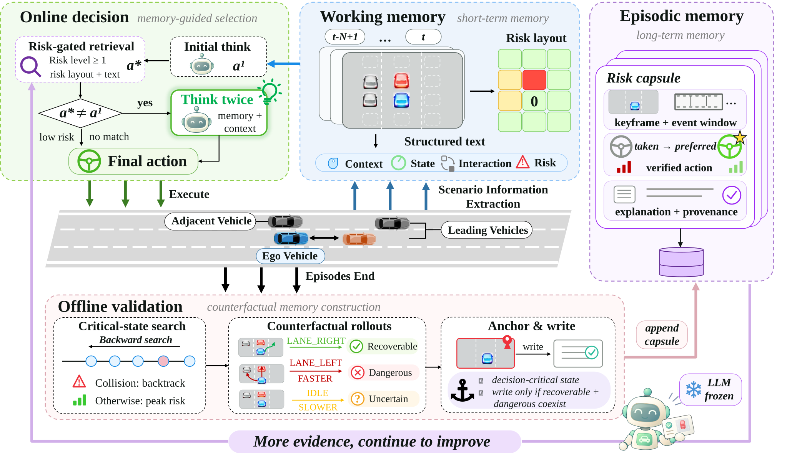

<h1 align="center">🧠XMind: Thinking Twice via Cross-Memory Reasoning for LLM-Based Autonomous Driving</h1>

<p align="center">
  <a href="https://arxiv.org/abs/2611.32209"></a>
  <a href="LICENSE"></a>
</p>

<p align="center">
  Zuyi Guo<sup>1</sup>, Xianjie Dai<sup>1</sup>, Lei Yang<sup>2</sup>, Xiaocong Zhao<sup>3</sup>, Jingguang Li<sup>1</sup>, Kitae Jang<sup>1</sup>, Heye Huang<sup>1&dagger;</sup>
</p>

<p align="center">
  <sup>1</sup> Korea Advanced Institute of Science and Technology<br>
  <sup>2</sup> Nanyang Technological University<br>
  <sup>3</sup> Tongji University
</p>

<p align="center"><i><sup>&dagger;</sup>Corresponding author</i></p>

## 🔍 Framework Overview

<p align="center">
  
</p>

XMind is a training-free framework that lets an LLM driving agent "think twice". The agent first
decides from working memory of recent traffic states, then cross-checks the decision against
episodic memory of critical risk events, in which alternative actions were verified by
counterfactual rollouts. If the two disagree, it decides again with the retrieved evidence.

## 🚀 Getting Started

### 1. Requirements 📦

We recommend a conda environment with Python 3.8:

```bash
conda create -n xmind python=3.8
conda activate xmind
pip install -r requirements.txt
```

XMind depends on specific library versions (e.g. `langchain==0.0.335`, `openai==0.28.1`,
`gymnasium==0.29.1`, `highway-env==1.8.2`), please install exactly the versions in `requirements.txt`.

Capsule retrieval uses the [bge-m3](https://huggingface.co/BAAI/bge-m3) text-embedding model. Download it 
to the repository (the default `model_path` is `bge-m3`):

```bash
huggingface-cli download BAAI/bge-m3 --local-dir bge-m3
```

### 2. Configuration ⚙️

All settings are in `config.yaml`.

- `scene_seeds`, `episodes_num`: one episode per seed, repeated `episodes_num` times
- `lanes_count`, `vehicles_density`, `simulation_duration`: highway-env traffic and episode length
- `working_memory_size`: number of recent frames in working memory
- `episodic_memory.retrieve`: retrieve risk capsules and decide twice when they disagree
- `episodic_memory.evolve`: build new risk capsules after every episode
- `episodic_memory.bank_dir`: folder of the capsule bank
- `model_path`: local bge-m3 folder (only loaded when `retrieve` is `true`)

The method parameters (counterfactual rollouts, capsule selection, retrieval weight) are fixed in
`XMind/episodic_memory/settings.py`.

### 3. Running XMind 🧠

```bash
python run_XMind.py
```

The script runs one episode for each seed in `scene_seeds`. Results are saved in
`results_<timestamp>/`, which contains `log.txt` (outcome, steps and decision paths of each episode),
`output.txt` (the full console output, including prompts and LLM replies) and the simulation videos.


#### Build episodic memory

Set `evolve: true` in `config.yaml`. After every episode XMind verifies the decision-critical state
with counterfactual rollouts and saves a risk capsule (`CAP000001.json`, ...) in `bank_dir`.
To evaluate with a fixed memory, set `evolve: false` and `retrieve: true`.


## 🔖 Citation

If you find XMind useful in your research, please cite our paper:

```bibtex
@article{guo2026xmind,
  title={XMind: Thinking Twice via Cross-Memory Reasoning for LLM-Based Autonomous Driving},
  author={Guo, Zuyi and Dai, Xianjie and Yang, Lei and Zhao, Xiaocong and Li, Jingguang and Jang, Kitae and Huang, Heye},
  journal={arXiv preprint arXiv:2611.32209},
  year={2026}
}
```

## 📝 License

XMind is released under the Apache 2.0 license. Parts of the codes are adapted from
[DiLu](https://github.com/PJLab-ADG/DiLu), which is also released under the Apache 2.0 license.
